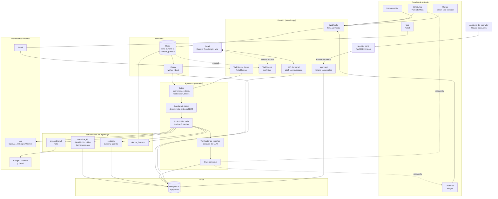
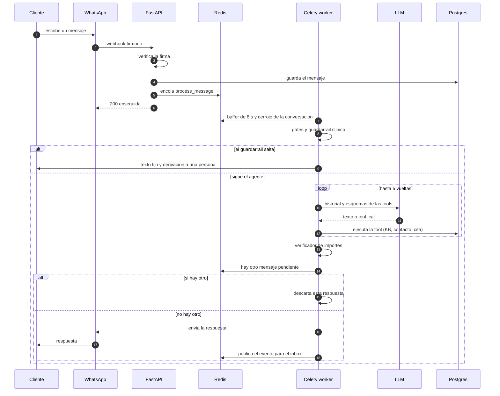

# Arquitectura de eskailet-chatbot (diagramas Mermaid)

Dos vistas del mismo sistema, leídas del código a fecha de 16 de octubre de 2026. El primero es la arquitectura de
componentes; el segundo, el recorrido de un mensaje. Se renderizan en GitHub, en VS Code (extensión de Mermaid) y en
<https://mermaid.live>.

## 1. Componentes

## 2. Recorrido de un mensaje (WhatsApp)

## Leyenda y límites

- Las flechas continuas son llamadas o flujo de datos; las punteadas son respuesta al cliente o eventos en vivo.
- Es **una instalación por cliente** (DEC-01): no hay nada compartido entre clientes y no es multi-tenant.
- El servidor MCP **no es** el camino del agente que habla con los clientes: sus herramientas son funciones del propio
  proceso. El MCP solo sirve para operar la instalación desde fuera.
- En voz no hay buffer de 8 s ni derivación a una persona en mitad de la llamada: se toman datos y se promete devolverla.
- El correo no envía: el agente deja un borrador en Gmail para que lo revise una persona.
